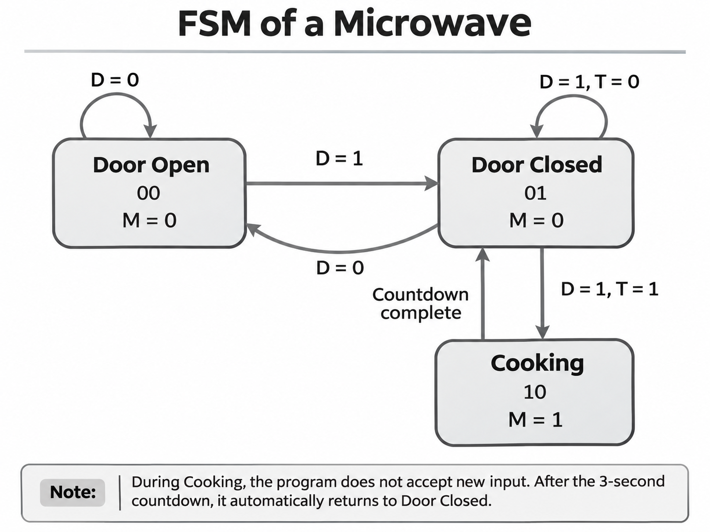
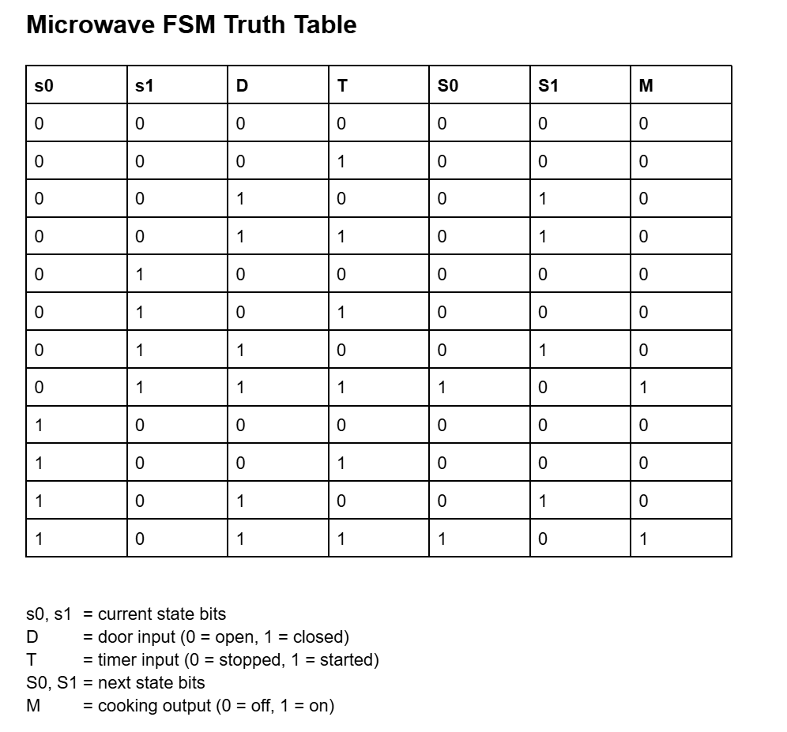
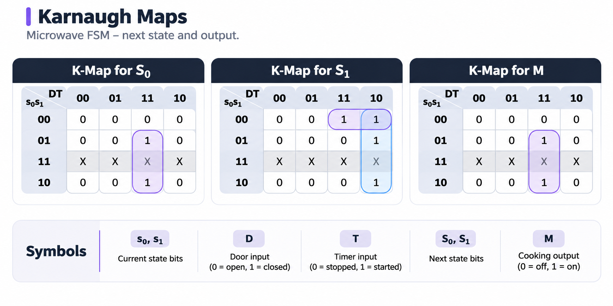
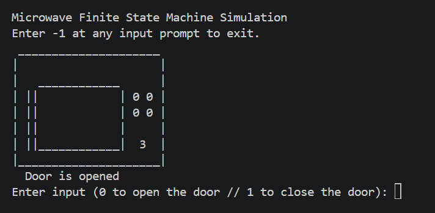
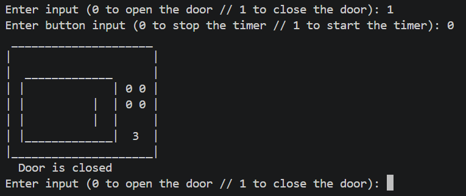
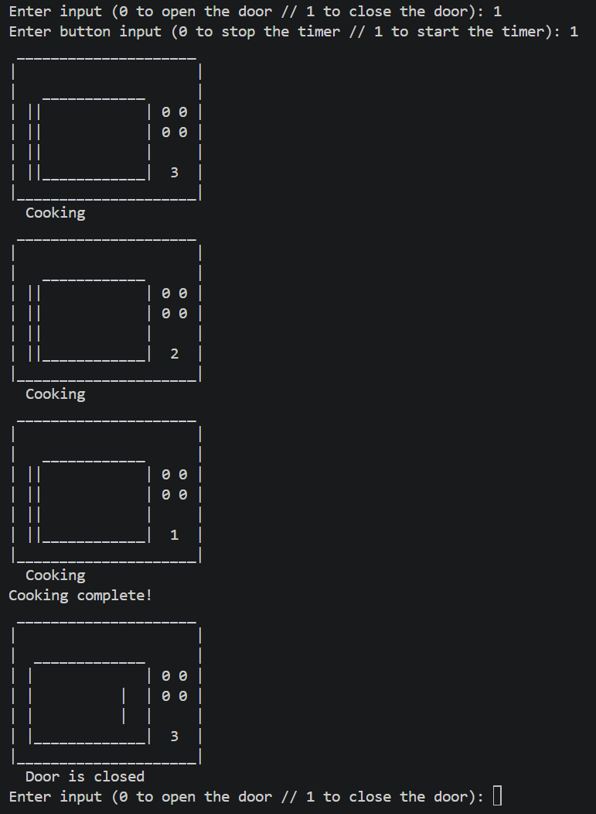
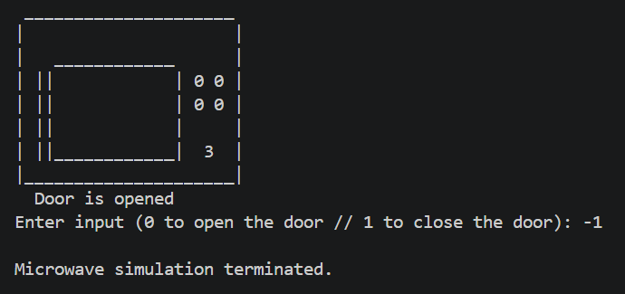

# FSM of a Microwave

A Finite State Machine (FSM) is a mathematical model used to represent systems with a finite number of states. Transitions between states occur based on specific inputs or events.

This project is a command-line microwave simulator developed in **C**. It uses two binary inputs (door and timer) and three operating states to simulate microwave functionality.

Originally developed as a first-semester university assignment in 2023, the project was revisited in 2026 to improve its functionality and reliability.

## Features

- Interactive command-line interface (CLI)
- Three operating states using FSM logic
- Door and timer controls using binary inputs
- Text-based microwave visualization
- Three-second cooking countdown
- Automatic return to Door Closed after cooking
- Input validation for invalid numbers and nonnumeric characters
- Program termination using `-1`

## States

1. **Door Open (00)** — The microwave door is open, and cooking cannot begin.
2. **Door Closed (01)** — The microwave door is closed and ready to start cooking.
3. **Cooking (10)** — The microwave performs its cooking countdown.

## Inputs

The simulation uses two binary inputs:

1. **D (0/1)** — Door Open (0) / Door Closed (1)
2. **T (0/1)** — Timer Stopped (0) / Timer Started (1)

Enter `-1` at either input prompt to exit the simulation.

## FSM Diagram

The diagram below illustrates the three operating states and their transitions.



The door must be closed before cooking can begin. After the countdown finishes, the microwave automatically returns to the Door Closed state.

## Truth Table

The truth table shows how the current state and inputs determine the next state and cooking output.



## Karnaugh Maps

Karnaugh maps illustrate the Boolean logic behind the FSM's state transitions and output.



The unused state `11` is represented by don't-care values (`X`) for Boolean simplification. The program uses conditional statements to implement the state transitions.

## Visualization

The microwave's operating states are displayed using text characters in the terminal.

### Door Open (00)



The initial state, where the microwave door is open.

### Door Closed (01)



The door is closed, and the microwave is ready to start cooking.

### Cooking (10)



The microwave counts down from three seconds and automatically returns to the Door Closed state when cooking finishes.

### Program Termination



Entering `-1` terminates the simulation.

## How to Run

### Requirements

- GCC compiler
- Terminal or command prompt
- Compatible C development environment (e.g., MSYS2 UCRT64 on Windows)

### Clone the Repository

```bash
git clone https://github.com/titoditomartin/fsm-improved.git
cd fsm-improved
```

Alternatively, download the repository as a ZIP file and extract it.

### Compile

```bash
gcc -c mylib/mylib.c -o mylib.o
gcc main.c mylib.o -o main.exe
```

### Run

On Windows:

```bash
./main.exe
```

### Controls

- **Door input:** `0` = Open, `1` = Closed
- **Timer input:** `0` = Stop, `1` = Start
- **Exit:** `-1`

To start cooking, close the door first, then enter `1` for both the door and timer inputs.

## Improvements

The original project was developed in 2023 as a first-semester university assignment. In 2026, I revisited the application to:

- Correct state-transition behavior
- Improve input validation and error handling
- Automatically return to Door Closed after cooking
- Add a proper exit option
- Improve code readability 

The original implementation and its academic documentation are preserved separately.

**Original Repository:** [fsm](https://github.com/titoditomartin/fsm)
